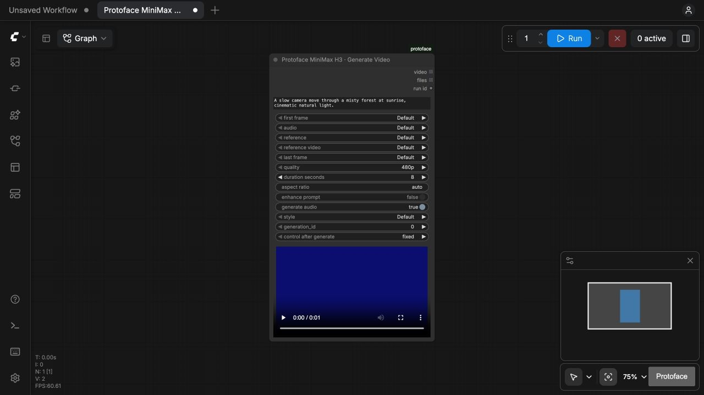
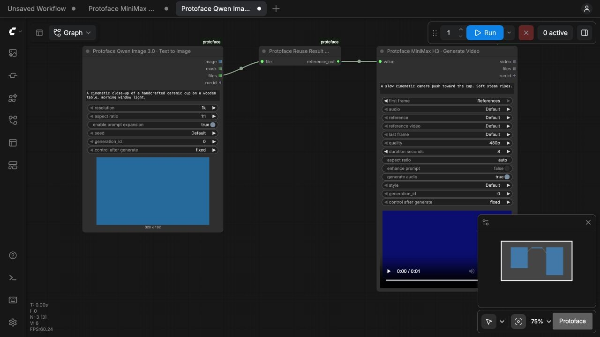

# Development and release

The adapter does not import the Protoface SDK/MCP runtime. It uses ordinary REST and runs in ComfyUI's Python environment. ComfyUI supplies Torch, NumPy and the native IO types; the extension adds HTTP and JSON Schema validation dependencies.

## Offline/mocked verification

Install development dependencies in a disposable environment. Set `COMFYUI_PATH` to an official checkout of a supported ComfyUI release, install that checkout's requirements into the same environment, then run:

```sh
COMFYUI_PATH=/path/to/ComfyUI python -m pytest
ruff check .
ruff format --check .
python scripts/sync_catalog.py protoface_comfyui/data/catalog.json --check
COMFYUI_PATH=/path/to/ComfyUI python scripts/generate_examples.py
python -m build
python scripts/check_public_content.py --archive dist/protoface_nodes-0.1.0.tar.gz --archive dist/protoface_nodes-0.1.0-py3-none-any.whl
```

Tests cover catalog completeness and history, native V3 schema registration, all current catalog tasks through ComfyUI's workflow engine, nested typed helpers, media roundtrips, multiple heterogeneous outputs, idempotent submission/recovery, cancellation, download auth isolation and download limits. No test calls a paid provider.

Native tests use temporary input, output and preview directories so they can run against a read-only ComfyUI checkout. The CI matrix checks the client/catalog and release guards on Python 3.10 and 3.13, plus Windows Python 3.12; native workflow tests target Linux and Windows Python 3.12 against pinned ComfyUI 0.41.0 and 0.42.1 releases. Use the actual Actions results to establish which checks have passed.

For a visual smoke test, install this folder under the checkout's `custom_nodes`, start the fixture API, and start ComfyUI with **mock credentials and a localhost API base**:

```sh
python scripts/mock_api.py --port 8199 --delay 3
# In another terminal:
PROTOFACE_BASE_URL=http://127.0.0.1:8199 \
PROTOFACE_API_KEY=local-mock-key \
PROTOFACE_STATE_DIR=/tmp/protoface-comfy-test \
python /path/to/ComfyUI/main.py --cpu --port 8189 --disable-auto-launch
```

The fixture returns synthetic files and records submissions at `/mock/stats`. It makes no network calls to Protoface or model providers. Its 3D bytes are a transport fixture, not a renderable mesh. Use real exported 3D fixtures for renderer validation.

## Updating the catalog

Live `/v1/models` discovery requires an API key. Offline startup and bundled-node browsing do not. The candidate workflow requires a dedicated `PROTOFACE_CATALOG_API_KEY` secret before it can be enabled; it exports only the customer-facing catalog response.

Supply a **public, sanitized** `/v1/models` response or exported catalog artifact to:

```sh
python scripts/sync_catalog.py /path/to/public-catalog.json
COMFYUI_PATH=/path/to/ComfyUI python scripts/generate_examples.py
```

Then run the full checks. The catalog generator fails on incomplete schemas, unresolved references, unsupported modalities/types, or arrays beyond the native Autogrow bound. Fix public metadata where possible; add a small reviewed shared adapter when genuinely new behavior appears. Keep runtime constraints in the API; presentation logic belongs here.

Release CI should receive only the public model catalog artifact. No private repository text, keys, account information or internal model details belong in this repository. Changes to pricing/copy should not require a node identity change. Input contract/output descriptor changes generate a new identity and archive old definitions. Preserve widget ordering and serialization within an existing node identity; an incompatible renderer change needs a deliberate node migration.

The public-content check rejects credential-shaped tokens, private state files, machine paths, cloud resource identifiers and non-public deployment URLs. It checks both source and built archives without printing matched values. Review screenshot contents and Git history separately before the first public push; a source cleanup does not remove content from earlier commits.

`catalog-candidate.yml` prepares a validated snapshot artifact from the authenticated catalog endpoint without commits, package publication or generations. Enable its schedule with the repository variable `PROTOFACE_CATALOG_REFRESH_ENABLED=true` only after the target contract is deployed. Review changes and run the native checks before including a candidate in a release. Installed users can refresh compatible catalog additions directly without waiting for that release.

## Production API validation

Use a separate state directory and a funded API key when starting local ComfyUI. The default endpoint is the production API:

```sh
PROTOFACE_API_KEY_FILE=/path/to/private-api-key \
PROTOFACE_STATE_DIR=/tmp/protoface-comfy-live \
python /path/to/ComfyUI/main.py --cpu --listen 127.0.0.1 --port 8189 --disable-auto-launch
```

The settings dialog shows the API endpoint. Confirm it is `https://api.protoface.com`, refresh the catalog, and validate templates before requesting a paid generation. Real provider tests require an explicit budget. Preserve generation IDs when checking caching or recovery; increment them only for an intended new generation. Keep keys, account data, live job histories and downloaded results outside the source tree.

## Release preparation

See [the release guide](releasing.md) for the manual build/draft/Registry workflow, publisher configuration, version checks and first-release checklist. Registry publication has not been performed. Compatible catalog updates can be fetched by users without a package update; new native adapters need a code release. Registry/Manager discovery is package-level before installation, while generated node-name search is available after installation. A GitHub repository alone does not populate everyone's Add Node search or the built-in template library.

## Tested baseline and sources

- ComfyUI **0.41.0**, official source commit `bdc63e72f5ab29fde448c161db3057827148c0ef`; frontend package **1.55.17**.
- ComfyUI **0.42.1**, official source commit `63be2f9b82ad0dac88a7ceaa28a9cf3154125a18`; frontend package **1.55.18**.
- Fresh macOS arm64 installations of both versions with Python **3.12.9**: all **37 automated checks passed per version** using copied custom-node folders and fresh environments, without an editable installation of this extension. Both registered **104 nodes** covering **44 models / 95 tasks** without a startup API key. The current frontend's credential setup, catalog refresh, template execution, workflow export and H3/LTX node search were verified. A source-archive install and a simulated package-version update resumed the same recorded mock run without another submission.
- Fresh ComfyUI 0.42.1 against the production API: authenticated catalog refresh and recovery of existing image, video and audio jobs through native save nodes passed. Account quota was unchanged; this fresh-install check submitted no paid generation. Earlier representative production generation tests cover image, video, audio and reference workflows, rather than a paid generation for every bundled task.
- macOS arm64: Python **3.12.9**, Torch **2.14.1**, PyAV **19.0.1**; native mocked workflow tests and representative live Dev workflows.
- Linux arm64 in a disposable CPU container: Python **3.12.15**, Torch **2.14.1+cpu**, PyAV **19.0.1**; all 37 mocked tests passed against the same official ComfyUI checkout. This does not establish Linux x86 or hosted-service compatibility.
- Client/catalog tests also passed on Python **3.10.16** and **3.13.2** on macOS. Native ComfyUI tests on those Python versions, Windows portable and Desktop distribution still need validation.
- [V3 node migration](https://docs.comfy.org/custom-nodes/v3/v3_migration)
- [Official native IO definitions](https://github.com/Comfy-Org/ComfyUI/blob/bdc63e72f5ab29fde448c161db3057827148c0ef/comfy_api/latest/_io.py)
- [Dynamic input execution tests](https://github.com/Comfy-Org/ComfyUI/blob/bdc63e72f5ab29fde448c161db3057827148c0ef/tests-unit/execution_test/dynamic_inputs_test.py)
- [Registry specifications](https://docs.comfy.org/registry/specifications)
- [Independent custom nodes](https://docs.comfy.org/development/core-concepts/custom-nodes)
- [Comfy Partner Nodes](https://docs.comfy.org/tutorials/partner-nodes/overview)

Recheck official APIs against the supported release before widening the version range.

The source distribution contains the ComfyUI entrypoint, frontend and templates and can be unpacked into `custom_nodes/protoface`. The Python wheel contains the shared adapter; installing that wheel alone does not install a ComfyUI extension. Registry installation must distribute the full custom-node source package.

## Local verification evidence

The H3 API-format example imported in ComfyUI's **File → Open** flow, ran against the localhost fixture, and resumed the same run after a server restart. A native video preview appeared with one recorded mock submission and zero paid generations. The Add Node library also found Protoface's H3 tasks by searching `minimax h3`.

Normal GUI templates also loaded through **Templates → the installed extension**. H3, LTX image-to-video and Qwen-to-H3 asset reuse all completed with native previews against the fixture. Headless JSON lives in `examples/api` because the Template Browser expects GUI workflow JSON. Blank GUI template request scopes are assigned after widget restoration so new copies receive their own intent.



This image shows synthetic test media, not a model-quality demonstration.


